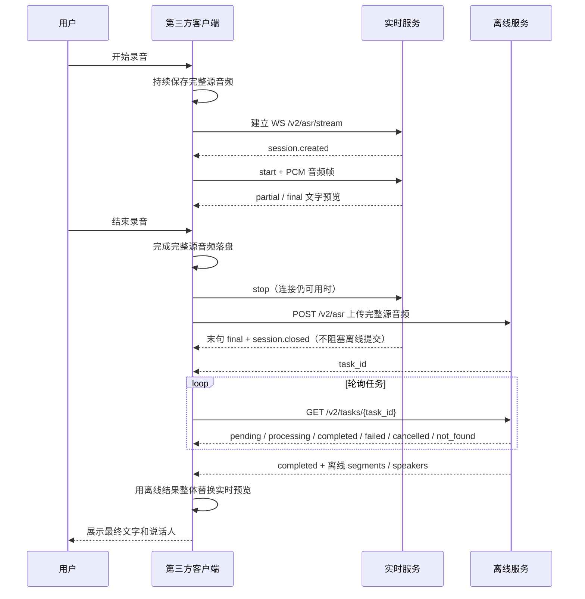

# 第三方客户端实时预览与离线定稿适配交接

**中文** | [English](第三方客户端实时预览与离线定稿适配交接_EN.md)

更新时间：2026-09-24

## 1. 结论

本次调整后，两条识别链路职责如下：

- **实时链路**：只提供转写文字预览，不执行说话人分离和声纹识别。
- **离线链路**：负责最终转写、说话人分离和声纹识别。
- **第三方客户端**：保存完整源音频，用户结束业务录音且音频落盘后主动提交离线任务，并用离线结果整体替换实时预览。

服务端不会在实时结束后自动调用离线接口。实时服务与离线服务可以部署在不同机器上，第三方客户端应分别配置两个服务地址。

## 2. 本次接口变化

| 范围 | 调整前 | 调整后 | 客户端处理 |
|------|--------|--------|------------|
| 原生实时 `WS /v2/asr/stream` | `final` 可能包含实时说话人标签或姓名 | 每条 `final` 固定包含 `speaker: null`、`speaker_name: null` | 保留字段解析，但不要在实时阶段展示说话人 |
| 实时能力声明 | `stream.speaker_labels`、`stream.speaker_identification` 可能为 `true` | 两个字段固定为 `false` | 不再根据实时能力开启说话人 UI |
| 实时请求参数 | 可提交 `diarize`、`identify_speakers`、`speaker_*` | 继续接受旧字段，但忽略，不启动实时说话人处理 | 新客户端停止发送；旧客户端无需立即删除 |
| DashScope 实时兼容 | 句末可能返回整型 `speaker_id` | 句末固定返回 `speaker_id: null` | 保留字段解析并允许 `null` |
| OpenAI 实时兼容 | 协议本身没有说话人字段 | 不变 | 无需适配说话人字段 |
| 离线 `POST /v2/asr` | 支持说话人分离和声纹识别 | 不变 | 最终结果继续以离线接口为准 |

实时返回结构保留空说话人字段，是为了避免已经按固定字段反序列化的客户端发生结构兼容问题。

## 3. 推荐架构

第三方系统维护两个独立地址：

```text
REALTIME_BASE_URL = 实时服务地址
OFFLINE_BASE_URL  = 离线服务地址
```

同一业务录音由第三方生成自己的 `client_job_id`，并保存以下关联关系：

```text
client_job_id
├── realtime_attempt_no[]      # 客户端生成的实时连接序号，从 1 递增
├── source_audio_path          # 第三方保存的完整原始音频
├── offline_submit_state       # 未提交、提交中、结果未知或已取得 task_id
└── offline_task_id            # POST /v2/asr 成功返回的任务 ID
```

实时服务当前不返回可用于跨连接关联的会话 ID。第三方应以
`(client_job_id, realtime_attempt_no, seg_id)` 唯一标识一条实时预览分段。
实时分段与离线任务没有关联，第三方需要自行保存 `client_job_id` 与离线 `task_id` 的映射。

## 4. 标准处理时序



客户端应分别维护业务录音和实时预览两个状态，二者并行运行：

```text
业务录音/离线：
RECORDING → AUDIO_READY → OFFLINE_SUBMITTING
                              ├─ 收到 task_id → OFFLINE_PROCESSING
                              │                    └→ COMPLETED | FAILED | CANCELLED | NOT_FOUND
                              └─ 未收到确定响应 → SUBMIT_UNKNOWN

实时预览：
DISCONNECTED → CONNECTING → STREAMING → ENDED
      ↑              断线后可重新连接       │
      └───────────────────────────────────┘
```

实时断线不代表业务录音结束。断线后客户端必须继续保存本地源音频，丢弃尚未收到
`final` 的当前 `partial`，递增 `realtime_attempt_no` 并建立新连接。新连接收到
`session.created` 后，只发送此后新采集的音频，不重放断线前的音频；断线期间采集的音频
只保存在本地完整录音中。此前已经提交显示的实时 `final` 可以保留，直到离线结果整体替换。

只有用户明确结束业务录音且完整音频完成落盘后，客户端才提交离线任务。离线提交不依赖
实时连接是否正常，也不依赖是否收到 `session.closed`。

## 5. 原生实时接口适配

### 5.1 连接与启动

```text
WS {REALTIME_BASE_URL}/v2/asr/stream?token=<api-key>
```

连接成功后，服务端先返回 `session.created`。该消息不包含可用于业务关联的会话 ID，
客户端应使用自己生成的 `realtime_attempt_no` 区分连接。客户端随后发送：

```json
{
  "type": "start",
  "audio_fs": 16000,
  "language": "zh",
  "wav_name": "client-job-001"
}
```

音频帧要求为 PCM16 小端、单声道，采样率与 `audio_fs` 一致。结束时发送：

```json
{"type": "stop"}
```

### 5.2 能力判断

连接前分别查询两个服务的能力：

```text
GET {REALTIME_BASE_URL}/v2/capabilities
GET {OFFLINE_BASE_URL}/v2/capabilities
```

两个端点使用相同的响应结构，与本次适配相关的字段如下：

```json
{
  "speaker_labels": true,
  "speaker_identification": true,
  "stream": {
    "enabled": true,
    "partial_results": true,
    "speaker_labels": false,
    "speaker_identification": false
  }
}
```

- 实时服务只读取 `stream.*`：`stream.speaker_labels`、`stream.speaker_identification` 固定为 `false`；`stream.partial_results=true` 时会收到 `partial`，为 `false` 时只收到逐句 `final`。
- 离线服务读取顶层 `speaker_labels`、`speaker_identification`，它们表示**离线能力**。
- 两个地址相同时可以复用一次响应；地址不同时必须分别查询，不要用实时服务器的顶层字段推断离线服务器能力。

示例中的顶层说话人能力值仅表示服务已启用对应模块，实际值以当前离线服务器返回为准。顶层能力为 `false` 时，客户端仍可提交离线转写，但最终结果不会提供对应的说话人信息。

### 5.3 实时消息处理

`partial.text` 是当前句的累计预览文本，内容可能被后续消息修订。客户端应替换当前预览行，不要把每条 `partial.text` 继续追加到全文。

```json
{
  "type": "partial",
  "seg_id": 0,
  "text": "今天讨论项目"
}
```

每条 `final` 固定保留空说话人字段：

```json
{
  "type": "final",
  "seg_id": 0,
  "text": "今天讨论项目进度。",
  "start": 320,
  "end": 3520,
  "speaker": null,
  "speaker_name": null
}
```

适配要求：

1. `speaker` 和 `speaker_name` 必须允许为 `null`。
2. 实时 UI 不展示说话人徽标、姓名或占位符。
3. `start`、`end` 的单位为毫秒。
4. 实时文字只作为预览，不作为最终存档结果。

## 6. 离线定稿接口适配

### 6.1 提交完整音频

用户结束业务录音并且完整源音频成功落盘后，第三方将该文件上传到离线服务：

```bash
curl -X POST "${OFFLINE_BASE_URL}/v2/asr" \
  -H "Authorization: Bearer <api-key>" \
  -F "file=@client-job-001.wav" \
  -F "language=zh" \
  -F "diarize=true" \
  -F "identify_speakers=true"
```

响应：

```json
{"task_id":"550e8400-e29b-41d4-a716-446655440000"}
```

`POST /v2/asr` 当前没有客户端幂等键，无法保证超时重试时只创建一个任务。客户端应：

1. 调用前持久化 `client_job_id`、音频文件和“提交中”状态，并使用可追踪的唯一文件名，例如
   `client-job-001.wav`。
2. 收到响应后立即持久化 `task_id`，后续页面刷新或进程恢复时继续轮询该任务。
3. 只有请求在本地明确未发出，或服务端明确返回请求未受理的 4xx 错误时，才能直接判定提交失败；修正请求后可以重新提交。
4. 除第 3 条的明确失败外，请求发出后只要客户端未取得并成功持久化 `task_id`，都将状态改为 `SUBMIT_UNKNOWN`，不要自动重新提交。这包括请求超时、连接断开、502/503 等代理或服务错误、响应体无法解析，以及进程在收到响应前或持久化 `task_id` 前退出。
5. 在同一离线服务调用 `GET /v2/tasks?history=true&limit=50`，按唯一 `wav_name` 和提交时间人工或受控核对是否已创建任务，再决定是否补提。

任务列表的最小响应结构如下：

```json
{
  "total": 1,
  "tasks": [
    {
      "task_id": "550e8400-e29b-41d4-a716-446655440000",
      "status": "processing",
      "progress": 0.45,
      "wav_name": "client-job-001.wav",
      "created_at": "2026-09-24T10:30:00",
      "finished_at": null,
      "error": null
    }
  ]
}
```

该接口没有按 `wav_name` 查询或游标分页能力。开启任务持久化后，`history=true` 会合并历史任务，并按创建时间倒序返回最多 `limit` 条；未开启时只能查当前内存中的任务。任务已过期、服务重启、结果超出查询范围或没有启用持久化时，列表中查不到任务不能证明提交未成功。完整字段见[获取任务列表](api/v2/tasks.md#获取任务列表)。

如果业务要求提交请求可以安全自动重试，需要服务端另行增加幂等键；当前接口不能仅靠客户端实现严格的一次提交。

### 6.2 轮询任务

```text
GET {OFFLINE_BASE_URL}/v2/tasks/{task_id}
Authorization: Bearer <api-key>
```

状态流转：

```text
pending → processing → completed | failed | cancelled
```

任务不存在时 HTTP 状态仍为 200，响应中的 `status` 为 `not_found`。客户端必须判断响应体的 `status`，不能只判断 HTTP 状态码。

各状态的处理规则如下：

| `status` | `result` | `error` | 客户端处理 |
|----------|----------|---------|------------|
| `pending` | `null` | `null` | 继续轮询 |
| `processing` | `null` | `null` | 继续轮询 |
| `completed` | 结果对象 | `null` | 停止轮询，作为唯一最终结果 |
| `failed` | `null` | 错误字符串 | 停止轮询，显示离线处理失败 |
| `cancelled` | 可能为 `null` 或部分结果 | 错误字符串 | 停止轮询，不得作为最终结果 |
| `not_found` | `null` | `null` | 停止轮询，提示任务不存在；此时 `progress` 为 `0` |

只有响应顶层 `status == "completed"` 且 `result` 非空时，才能将 `result` 用于最终存档。其他终态不得回退使用实时预览作为最终结果。

### 6.3 使用最终结果

离线成功响应示例：

```json
{
  "task_id": "550e8400-e29b-41d4-a716-446655440000",
  "status": "completed",
  "progress": 1.0,
  "result": {
    "segments": [
      {
        "start": 0.0,
        "end": 3.2,
        "text": "大家好。",
        "speaker": "A",
        "speaker_name": "张三"
      },
      {
        "start": 3.5,
        "end": 6.0,
        "text": "我先说两句。",
        "speaker": "B",
        "speaker_name": "李四"
      }
    ],
    "full_text": "大家好。我先说两句。",
    "speakers": [
      {
        "label": "A",
        "speaker_id": "9f86d081884c7d659a2feaa0c55ad015",
        "name": "张三",
        "score": 0.62
      },
      {
        "label": "B",
        "speaker_id": "3c2a91f0a1b24e83b6f1c2d3e4f5a6b7",
        "name": "李四",
        "score": 0.58
      }
    ]
  },
  "error": null
}
```

客户端应直接使用离线 `result.segments` 重建最终分段列表。不要按实时 `seg_id` 或时间戳逐段合并，原因如下：

- 实时与离线使用不同的断句策略，分段数量可能不同。
- 实时 `start`、`end` 使用毫秒，离线 `segments[].start`、`end` 使用秒。
- 离线处理可能调整标点、文字和说话人边界。

应用离线 `completed` 结果后，客户端应立即把该 `client_job_id` 标记为已定稿，关闭或解绑它的实时连接，并丢弃此后从该业务录音所有实时连接收到的 `partial`、`final`、`error` 和 `session.closed`。这样可以避免延迟到达的实时消息覆盖或追加到离线定稿结果。

说话人字段会根据离线服务能力和请求参数采用以下结构：

| 处理情况 | `segments[]` | `result.speakers` |
|----------|--------------|-------------------|
| 未启用、被忽略或处理失败 | 不包含 `speaker`、`speaker_name` | 不存在 |
| 已启用说话人分离，但音频中没有有效语音 | 空数组 | 空数组 |
| 已执行说话人分离，未执行声纹识别 | 包含 `speaker`；不包含 `speaker_name` | 字符串数组，例如 `["A", "B"]` |
| 已执行说话人分离和声纹识别 | 包含 `speaker`；仅命中的分段包含 `speaker_name` | 对象数组；未命中项的 `speaker_id`、`name` 可为 `null` |

`result.warnings` 是可选的字符串数组。当请求参数因服务能力未开启而被忽略时，客户端可以展示或记录其中的提示。

## 7. 实时与离线分机部署

当两个服务部署在不同机器时，客户端分别完成能力检查和鉴权：

| 项目 | 实时服务 | 离线服务 |
|------|----------|----------|
| 地址 | `REALTIME_BASE_URL` | `OFFLINE_BASE_URL` |
| 能力检查 | `GET /v2/capabilities`，读取 `stream.*` | `GET /v2/capabilities`，读取顶层说话人能力 |
| 任务标识 | 客户端生成的 `(client_job_id, realtime_attempt_no, seg_id)` | `POST /v2/asr` 返回的 `task_id` |
| 音频来源 | 实时 PCM 帧 | 第三方保存的完整音频文件 |
| 结果用途 | 临时预览 | 最终存档和业务回传 |

两个服务的 API Key 可以不同，客户端应分别配置。不要假设两个服务共享任务、录音目录或内存状态。

## 8. 兼容接口适配

### 8.1 DashScope 实时兼容

客户端仍可发送 `diarization_enabled`，服务端会接受并忽略。

vLLM 中间结果不包含 `speaker_id`：

```json
{
  "begin_time": null,
  "end_time": null,
  "text": "今天讨论项目",
  "sentence_end": false
}
```

句末结果固定包含 `speaker_id: null`：

```json
{
  "begin_time": 320,
  "end_time": 3520,
  "text": "今天讨论项目进度。",
  "sentence_end": true,
  "speaker_id": null
}
```

### 8.2 OpenAI 实时兼容

OpenAI Realtime 协议没有说话人字段，本次无需增加字段适配。`delta` 用于增量预览，
`conversation.item.input_audio_transcription.completed` 表示实时会话内的一条完整预览句子；
业务最终文字和说话人仍只以离线任务的 `completed` 结果为准。

### 8.3 离线兼容接口

OpenAI、DashScope 的离线兼容接口保持原有行为。需要完整的说话人和声纹结果时，推荐第三方使用原生 `POST /v2/asr`，便于统一获取 `segments`、`speakers` 和任务状态。

## 9. 客户端改造清单

- [ ] 分别配置实时服务地址和离线服务地址。
- [ ] 录音期间由第三方持续保存完整源音频。
- [ ] 实时 `speaker`、`speaker_name`、DashScope `speaker_id` 支持 `null`。
- [ ] 实时界面不展示说话人信息。
- [ ] `partial.text` 按当前句全文替换，不连续追加。
- [ ] 使用 `(client_job_id, realtime_attempt_no, seg_id)` 标识实时预览分段。
- [ ] 实时断线后丢弃未完成的 `partial`，新连接只发送新采集的音频。
- [ ] 用户结束业务录音且完整音频落盘后，由第三方调用 `POST /v2/asr`。
- [ ] 收到响应后持久化离线 `task_id`；提交结果未知时禁止自动重试。
- [ ] 除 6.1 节第 3 条的明确失败外，所有“已发出请求但未持久化 `task_id`”的情况都进入 `SUBMIT_UNKNOWN`。
- [ ] 根据响应体 `status` 轮询离线任务。
- [ ] 仅将 `completed` 结果用于最终存档，正确处理其他终态。
- [ ] 离线完成后整体替换实时预览，不按实时分段做合并。
- [ ] 应用离线定稿后关闭或解绑实时连接，并忽略该录音后续所有实时消息。
- [ ] 最终存档、导出和下游业务只使用离线结果。
- [ ] 实时断线时继续保存源音频，允许重新连接预览。
- [ ] 兼容离线说话人字段不存在、字符串数组和对象数组三种结构。
- [ ] 分别处理实时失败和离线失败状态。

## 10. 联调验收用例

| 编号 | 场景 | 预期结果 |
|------|------|----------|
| 1 | 原生实时正常推流 | 能显示文字；每条 `final` 都有 `speaker:null`、`speaker_name:null` |
| 2 | vLLM 实时产生多条 `partial` | 页面只更新当前预览行，没有重复追加文本 |
| 3 | standard 实时无 `partial` | 客户端仅依赖逐句 `final` 也能正常展示 |
| 4 | DashScope 实时句末结果 | `speaker_id` 字段存在且值为 `null` |
| 5 | 发送旧实时说话人参数 | 会话可继续使用，但不产生实时说话人结果 |
| 6 | 实时连接中断后重连 | 本地录音不中断；未完成 `partial` 被丢弃；新连接不重放旧音频 |
| 7 | 实时与离线位于不同机器 | 两条链路分别鉴权并正常完成，不依赖共享目录 |
| 8 | 离线开启说话人和声纹 | 最终分段包含匿名标签，命中时包含姓名 |
| 9 | 离线声纹未命中 | 最终文字和匿名标签正常；姓名字段缺失或对象值为 `null` 时客户端不报错 |
| 10 | 离线任务失败 | 实时预览不被当作最终结果，页面明确显示离线失败 |
| 11 | 离线提交请求超时且未收到响应 | 进入 `SUBMIT_UNKNOWN`，不自动重复上传 |
| 12 | 离线未启用说话人能力 | `segments` 无说话人字段且 `speakers` 不存在，客户端正常显示文字 |
| 13 | 离线定稿后收到延迟实时消息 | 客户端丢弃消息，最终页面和存档保持离线结果不变 |

## 11. 相关接口文档

- [v2 转写接口](api/v2/transcription.md)
- [v2 任务管理](api/v2/tasks.md)
- [v2 说话人与声纹识别](api/v2/speakers.md)
- [OpenAI / DashScope 兼容接口](api/compat.md)
