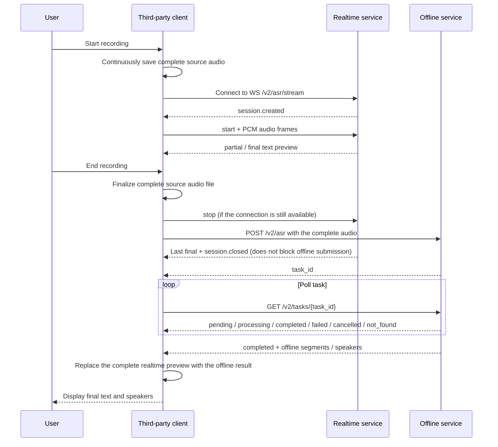

# Third-Party Client Integration Handoff: Realtime Preview and Offline Finalization

[中文](第三方客户端实时预览与离线定稿适配交接.md) | **English**

Updated: 2026-09-24

## 1. Summary

After this change, the two transcription paths have separate responsibilities:

- **Realtime path**: provides a text preview only. It does not run speaker diarization or voiceprint identification.
- **Offline path**: produces the final transcript, speaker diarization, and voiceprint identification.
- **Third-party client**: saves the complete source audio, submits an offline task after the user ends the business recording and the audio file is finalized, then replaces the entire realtime preview with the offline result.

The server does not call the offline endpoint automatically when realtime streaming ends. The realtime and offline services may run on different machines, so the third-party client must configure their addresses separately.

## 2. API Changes

| Area | Before | After | Client action |
|------|--------|-------|---------------|
| Native realtime `WS /v2/asr/stream` | A `final` event could contain a realtime speaker label or name | Every `final` event always contains `speaker: null` and `speaker_name: null` | Keep parsing the fields, but do not show speaker information during realtime preview |
| Realtime capabilities | `stream.speaker_labels` and `stream.speaker_identification` could be `true` | Both fields are always `false` | Do not enable speaker UI from realtime capabilities |
| Realtime request options | Clients could send `diarize`, `identify_speakers`, and `speaker_*` | The service still accepts legacy fields but ignores them and does not start realtime speaker processing | New clients should stop sending them; existing clients do not need an immediate removal |
| DashScope realtime compatibility | A sentence-final result could contain an integer `speaker_id` | A sentence-final result always contains `speaker_id: null` | Keep parsing the field and allow `null` |
| OpenAI realtime compatibility | The protocol has no speaker field | Unchanged | No speaker-field adaptation is required |
| Offline `POST /v2/asr` | Supports speaker diarization and voiceprint identification | Unchanged | Continue using the offline endpoint as the source of the final result |

Empty speaker fields remain in realtime responses so clients that deserialize a fixed schema do not break.

## 3. Recommended Architecture

The third-party system should maintain two independent addresses:

```text
REALTIME_BASE_URL = realtime service address
OFFLINE_BASE_URL  = offline service address
```

Generate a `client_job_id` for each business recording and persist the following relationships:

```text
client_job_id
├── realtime_attempt_no[]      # Client-generated realtime connection number, starting at 1
├── source_audio_path          # Complete source audio saved by the client
├── offline_submit_state       # Not submitted, submitting, unknown, or task_id received
└── offline_task_id            # Task ID returned by POST /v2/asr
```

The realtime service does not currently return a session ID that can correlate separate connections. Use `(client_job_id, realtime_attempt_no, seg_id)` as the unique key for a realtime preview segment. Realtime segments have no relationship to the offline task; the client must persist its own mapping between `client_job_id` and the offline `task_id`.

## 4. Standard Processing Sequence



Maintain separate, concurrent state machines for the business recording and the realtime preview:

```text
Business recording / offline:
RECORDING → AUDIO_READY → OFFLINE_SUBMITTING
                              ├─ task_id received → OFFLINE_PROCESSING
                              │                       └→ COMPLETED | FAILED | CANCELLED | NOT_FOUND
                              └─ no definitive response → SUBMIT_UNKNOWN

Realtime preview:
DISCONNECTED → CONNECTING → STREAMING → ENDED
      ↑              reconnect after failure      │
      └───────────────────────────────────────────┘
```

A realtime disconnection does not end the business recording. The client must keep saving the local source audio, discard the current `partial` if it has not received a matching `final`, increment `realtime_attempt_no`, and create a new connection. After the new connection receives `session.created`, send only audio captured from that point onward; do not replay audio from before the disconnection. Audio captured during the gap remains only in the complete local recording. Previously displayed realtime `final` events may remain visible until the offline result replaces them.

Submit the offline task only after the user explicitly ends the business recording and the complete audio file has been finalized. Offline submission does not depend on the realtime connection state or on receiving `session.closed`.

## 5. Native Realtime API Adaptation

### 5.1 Connect and Start

```text
WS {REALTIME_BASE_URL}/v2/asr/stream?token=<api-key>
```

After the connection is established, the server first sends `session.created`. This message does not contain a session ID suitable for business correlation, so the client must distinguish connections with its own `realtime_attempt_no`. The client then sends:

```json
{
  "type": "start",
  "audio_fs": 16000,
  "language": "zh",
  "wav_name": "client-job-001"
}
```

Audio frames must be little-endian PCM16, mono, with a sample rate matching `audio_fs`. To finish the session, send:

```json
{"type": "stop"}
```

### 5.2 Capability Detection

Before connecting, query both services separately:

```text
GET {REALTIME_BASE_URL}/v2/capabilities
GET {OFFLINE_BASE_URL}/v2/capabilities
```

Both endpoints use the same response shape. The fields relevant to this integration are:

```json
{
  "speaker_labels": true,
  "speaker_identification": true,
  "stream": {
    "enabled": true,
    "partial_results": true,
    "speaker_labels": false,
    "speaker_identification": false
  }
}
```

- On the realtime service, read only `stream.*`. `stream.speaker_labels` and `stream.speaker_identification` are always `false`. When `stream.partial_results=true`, the client receives `partial` events; when it is `false`, the client receives only sentence-level `final` events.
- On the offline service, read top-level `speaker_labels` and `speaker_identification`; they describe **offline capabilities**.
- When both addresses are the same, one response may be reused. When they differ, query each service and never infer offline capabilities from the realtime server's top-level fields.

The top-level speaker values in this example only show a service with the relevant modules enabled. Use the actual response from the offline server. When a top-level capability is `false`, the client may still submit an offline transcription, but the final result will not contain the corresponding speaker information.

### 5.3 Realtime Message Handling

`partial.text` is the cumulative preview for the current sentence and may be revised by later messages. Replace the current preview row instead of appending every `partial.text` value to the transcript.

```json
{
  "type": "partial",
  "seg_id": 0,
  "text": "今天讨论项目"
}
```

Every `final` event retains empty speaker fields:

```json
{
  "type": "final",
  "seg_id": 0,
  "text": "今天讨论项目进度。",
  "start": 320,
  "end": 3520,
  "speaker": null,
  "speaker_name": null
}
```

Client requirements:

1. `speaker` and `speaker_name` must accept `null`.
2. Do not show a speaker badge, name, or placeholder in the realtime UI.
3. `start` and `end` are in milliseconds.
4. Realtime text is a preview and must not be stored as the final transcript.

## 6. Offline Finalization API Adaptation

### 6.1 Submit the Complete Audio

After the user ends the business recording and the complete source audio is successfully finalized, upload that file to the offline service:

```bash
curl -X POST "${OFFLINE_BASE_URL}/v2/asr" \
  -H "Authorization: Bearer <api-key>" \
  -F "file=@client-job-001.wav" \
  -F "language=zh" \
  -F "diarize=true" \
  -F "identify_speakers=true"
```

Response:

```json
{"task_id":"550e8400-e29b-41d4-a716-446655440000"}
```

`POST /v2/asr` does not currently accept a client idempotency key, so a retry after an uncertain response cannot be guaranteed to create only one task. The client must:

1. Before calling the endpoint, persist the `client_job_id`, audio file, and “submitting” state. Use a unique, traceable filename such as `client-job-001.wav`.
2. Persist the returned `task_id` immediately. After a page refresh or process restart, continue polling that task.
3. Treat submission as a definite failure only when the request was clearly never sent locally, or the service explicitly returns a 4xx response that confirms the request was not accepted. The client may submit again after correcting the request.
4. Except for the definite failures in step 3, once the request is sent, set the state to `SUBMIT_UNKNOWN` whenever the client does not obtain and successfully persist a `task_id`. Do not retry automatically. This includes timeouts, connection loss, proxy or service errors such as 502/503, an invalid response body, and a process exit before receiving the response or persisting the `task_id`.
5. On the same offline service, call `GET /v2/tasks?history=true&limit=50` and use the unique `wav_name` plus submission time to reconcile the task manually or through a controlled recovery process before deciding whether to resubmit.

Minimum task-list response:

```json
{
  "total": 1,
  "tasks": [
    {
      "task_id": "550e8400-e29b-41d4-a716-446655440000",
      "status": "processing",
      "progress": 0.45,
      "wav_name": "client-job-001.wav",
      "created_at": "2026-09-24T10:30:00",
      "finished_at": null,
      "error": null
    }
  ]
}
```

The endpoint does not support filtering by `wav_name` or cursor pagination. With task persistence enabled, `history=true` merges persisted history and returns at most `limit` tasks in descending creation-time order. Without task persistence, only current in-memory tasks are available. A task missing from the list does not prove that submission failed when the task has expired, the service restarted, the result falls outside the query range, or persistence is disabled. See [Get Task List](api/v2/tasks_EN.md) for the complete fields.

If the business requires safe automatic submission retries, the server must add an idempotency key. The current interface cannot provide strict exactly-once submission through client logic alone.

### 6.2 Poll the Task

```text
GET {OFFLINE_BASE_URL}/v2/tasks/{task_id}
Authorization: Bearer <api-key>
```

State flow:

```text
pending → processing → completed | failed | cancelled
```

When a task does not exist, the HTTP status is still 200 and the response body has `status: "not_found"`. The client must inspect the response-body status instead of relying only on the HTTP status code.

Handle each status as follows:

| `status` | `result` | `error` | Client action |
|----------|----------|---------|---------------|
| `pending` | `null` | `null` | Continue polling |
| `processing` | `null` | `null` | Continue polling |
| `completed` | Result object | `null` | Stop polling and use it as the only final result |
| `failed` | `null` | Error string | Stop polling and show an offline-processing failure |
| `cancelled` | May be `null` or a partial result | Error string | Stop polling; do not use it as the final result |
| `not_found` | `null` | `null` | Stop polling and report a missing task; `progress` is `0` |

Store `result` as the final transcript only when the response's top-level `status == "completed"` and `result` is non-null. For every other terminal status, do not fall back to the realtime preview as the final result.

### 6.3 Apply the Final Result

Example successful offline response:

```json
{
  "task_id": "550e8400-e29b-41d4-a716-446655440000",
  "status": "completed",
  "progress": 1.0,
  "result": {
    "segments": [
      {
        "start": 0.0,
        "end": 3.2,
        "text": "大家好。",
        "speaker": "A",
        "speaker_name": "张三"
      },
      {
        "start": 3.5,
        "end": 6.0,
        "text": "我先说两句。",
        "speaker": "B",
        "speaker_name": "李四"
      }
    ],
    "full_text": "大家好。我先说两句。",
    "speakers": [
      {
        "label": "A",
        "speaker_id": "9f86d081884c7d659a2feaa0c55ad015",
        "name": "张三",
        "score": 0.62
      },
      {
        "label": "B",
        "speaker_id": "3c2a91f0a1b24e83b6f1c2d3e4f5a6b7",
        "name": "李四",
        "score": 0.58
      }
    ]
  },
  "error": null
}
```

Rebuild the final segment list directly from offline `result.segments`. Do not merge it segment by segment using realtime `seg_id` values or timestamps because:

- Realtime and offline processing use different sentence-boundary strategies, so the segment counts may differ.
- Realtime `start` and `end` values are milliseconds; offline `segments[].start` and `end` values are seconds.
- Offline processing may revise punctuation, text, and speaker boundaries.

After applying the offline `completed` result, immediately mark the `client_job_id` as finalized, close or detach its realtime connection, and discard every later `partial`, `final`, `error`, or `session.closed` message from all realtime connections for that business recording. This prevents a delayed realtime message from overwriting or appending to the offline final result.

Speaker fields vary with offline capabilities and request options:

| Processing case | `segments[]` | `result.speakers` |
|-----------------|--------------|-------------------|
| Diarization disabled, ignored, or failed | Does not contain `speaker` or `speaker_name` | Absent |
| Diarization enabled but no valid speech found | Empty array | Empty array |
| Diarization completed without voiceprint identification | Contains `speaker`; does not contain `speaker_name` | String array, for example `["A", "B"]` |
| Diarization and voiceprint identification completed | Contains `speaker`; only matched segments contain `speaker_name` | Object array; unmatched entries may have `speaker_id` and `name` set to `null` |

`result.warnings` is an optional string array. The client may display or record warnings when request options were ignored because a service capability was unavailable.

## 7. Separate Realtime and Offline Deployments

When the two services run on different machines, perform capability checks and authentication separately:

| Item | Realtime service | Offline service |
|------|------------------|-----------------|
| Address | `REALTIME_BASE_URL` | `OFFLINE_BASE_URL` |
| Capability check | `GET /v2/capabilities`; read `stream.*` | `GET /v2/capabilities`; read top-level speaker capabilities |
| Task identifier | Client-generated `(client_job_id, realtime_attempt_no, seg_id)` | `task_id` returned by `POST /v2/asr` |
| Audio source | Realtime PCM frames | Complete audio file saved by the third party |
| Result purpose | Temporary preview | Final archive and downstream business response |

The services may use different API keys, so configure them separately. Do not assume that they share tasks, recording directories, or in-memory state.

## 8. Compatibility API Adaptation

### 8.1 DashScope Realtime Compatibility

The client may still send `diarization_enabled`; the server accepts and ignores it.

A vLLM intermediate result does not contain `speaker_id`:

```json
{
  "begin_time": null,
  "end_time": null,
  "text": "今天讨论项目",
  "sentence_end": false
}
```

A sentence-final result always contains `speaker_id: null`:

```json
{
  "begin_time": 320,
  "end_time": 3520,
  "text": "今天讨论项目进度。",
  "sentence_end": true,
  "speaker_id": null
}
```

### 8.2 OpenAI Realtime Compatibility

The OpenAI Realtime protocol has no speaker field, so no new field adaptation is required. `delta` events provide the incremental preview. `conversation.item.input_audio_transcription.completed` represents one complete preview sentence within the realtime session. The business-final text and speakers still come only from the offline task's `completed` result.

### 8.3 Offline Compatibility APIs

The existing behavior of the OpenAI and DashScope offline compatibility APIs is unchanged. When complete diarization and voiceprint results are required, third-party clients should use native `POST /v2/asr` so `segments`, `speakers`, and task state have one consistent shape.

## 9. Client Migration Checklist

- [ ] Configure the realtime and offline service addresses separately.
- [ ] Continuously save the complete source audio on the third-party side during recording.
- [ ] Accept `null` for realtime `speaker`, `speaker_name`, and DashScope `speaker_id`.
- [ ] Do not display speaker information in the realtime UI.
- [ ] Replace the current sentence with `partial.text`; do not append every partial.
- [ ] Identify realtime preview segments with `(client_job_id, realtime_attempt_no, seg_id)`.
- [ ] After a realtime disconnection, discard the unfinished `partial`; send only newly captured audio on the new connection.
- [ ] Call `POST /v2/asr` only after the user ends the business recording and the complete audio file is finalized.
- [ ] Persist the offline `task_id` after receiving it; never retry automatically when the submission result is unknown.
- [ ] Except for definite failures described in section 6.1 step 3, put every “request sent but `task_id` not persisted” case into `SUBMIT_UNKNOWN`.
- [ ] Poll offline tasks by inspecting the response-body `status`.
- [ ] Use only `completed` results for final storage and handle every other terminal status explicitly.
- [ ] Replace the whole realtime preview after offline completion; do not merge realtime segments.
- [ ] After applying the offline final result, close or detach realtime connections and ignore every later realtime message for that recording.
- [ ] Use only the offline result for final storage, export, and downstream business processing.
- [ ] Keep saving source audio during realtime disconnections and allow preview reconnection.
- [ ] Support all offline speaker-result shapes: fields absent, string array, and object array.
- [ ] Handle realtime and offline failures independently.

## 10. Integration Acceptance Cases

| No. | Scenario | Expected result |
|-----|----------|-----------------|
| 1 | Native realtime streaming | Text is displayed; every `final` contains `speaker:null` and `speaker_name:null` |
| 2 | vLLM realtime emits multiple `partial` events | The page updates only the current preview row without duplicated appended text |
| 3 | Standard realtime emits no `partial` events | The client still displays the transcript using sentence-level `final` events only |
| 4 | DashScope realtime sentence-final result | The `speaker_id` field exists and is `null` |
| 5 | Client sends legacy realtime speaker options | The session continues, but no realtime speaker result is produced |
| 6 | Realtime connection drops and reconnects | Local recording continues; unfinished `partial` is discarded; the new connection does not replay old audio |
| 7 | Realtime and offline services run on separate machines | Both paths authenticate and complete independently without a shared directory |
| 8 | Offline diarization and voiceprint identification enabled | Final segments contain anonymous labels and matched segments contain names |
| 9 | Offline voiceprint does not match | Final text and anonymous labels remain valid; missing names or `null` object values do not break the client |
| 10 | Offline task fails | Realtime preview is not treated as final, and the UI clearly reports the offline failure |
| 11 | Offline submission times out without a response | State becomes `SUBMIT_UNKNOWN`; the client does not upload again automatically |
| 12 | Offline speaker capability disabled | `segments` has no speaker fields and `speakers` is absent; the client still displays text |
| 13 | Delayed realtime message arrives after offline finalization | The client discards the message; the final UI and stored result remain unchanged |

## 11. Related API Documentation

- [v2 Transcription API](api/v2/transcription_EN.md)
- [v2 Task Management](api/v2/tasks_EN.md)
- [v2 Speaker and Voiceprint Identification](api/v2/speakers_EN.md)
- [OpenAI / DashScope Compatibility APIs](api/compat_EN.md)
